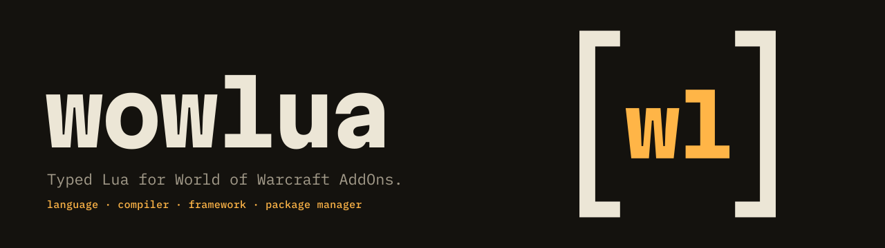

<p align="center">
  <picture>
    <source media="(prefers-color-scheme: dark)" srcset=".github/assets/wowlua-banner-dark.svg">
    <source media="(prefers-color-scheme: light)" srcset=".github/assets/wowlua-banner-light.svg">
    
  </picture>
</p>

<p align="center">
  <a href="https://github.com/DomenikIrrgang/wowlua/actions/workflows/ci.yml"></a>
  <a href="https://github.com/DomenikIrrgang/wowlua/releases/latest"></a>
  
  <a href="LICENSE"></a>
</p>

<p align="center">
  <a href="#install">install</a> ·
  <a href="#quick-start">quick start</a> ·
  <a href="#bring-your-addon">bring your addon</a> ·
  <a href="spec/README.md">specification</a> ·
  <a href="spec/roadmap.md">roadmap</a> ·
  <a href="https://github.com/DomenikIrrgang/wowlua/releases">releases</a>
</p>

---

**wowlua** is a language, compiler, framework and package manager for World of
Warcraft AddOns, shipped as one binary. It type-checks your code against the
WoW API of every game flavor, builds a complete AddOn, and publishes it to
CurseForge, Wago, WoWInterface and GitHub with one command. Every Lua file you
have today is already valid wowlua.

## Four tools, one binary

| | |
|---|---|
| **Language** | `.wowlua` is a strict superset of Lua 5.1, the dialect WoW runs. It adds gradual types, classes, interfaces, enums, decorators, `import`/`export` modules, reflection, compile-time build information and syntax sugar (`+=`, `continue`, `?.`, `??`, string interpolation, …). Everything compiles to plain Lua 5.1. |
| **Compiler** | Written in Rust. It type-checks your code and always emits a complete, installable AddOn: TOC files for every flavor, embedded libraries, assets and only the runtime pieces you use. Release builds are bundled and minified to the level you choose, to keep in-game load times low. |
| **Framework** | A typed standard library for what almost every addon needs: events, saved variables, slash commands, timers, localization, settings, a minimap button, addon comms, serialization and logging. |
| **Package manager** | A `wowlua.json` manifest describes the addon. Dependencies are resolved, locked and embedded. Finished addons are packaged and uploaded to every configured addon site. |

## A taste

```lua
-- src/main.wowlua
import addon, build from "wowlua:meta"
import event from "wowlua:events"
import log from "wowlua:log"

export class Counter
    private count: number = 0

    @profile
    function increment(by: number = 1): number
        self.count += by
        return self.count
    end
end

local counter = Counter.new()

@event("PLAYER_LOGIN")
local function onLogin()
    log.info(`{addon.title} {addon.version} loaded ({build.profile} build)`)
    if build.debug then
        counter:increment()
    end
end
```

Mistakes show up before `/reload`, in the format your terminal already knows:

```text
error[E2003]: `Ledger` has no field or method `balanse`
   ┌─ src/main.wowlua:88:10
   │
88 │ print(l2.balanse)
   │          ^^^^^^^ here
```

## Install

macOS and Linux:

```sh
curl -fsSL https://github.com/DomenikIrrgang/wowlua/releases/latest/download/install.sh | sh
```

Windows (PowerShell):

```powershell
irm https://github.com/DomenikIrrgang/wowlua/releases/latest/download/install.ps1 | iex
```

From source (Rust 1.96 or newer):

```sh
cargo install --path crates/wowlua-cli
```

## Quick start

```sh
wowlua new MyAddon && cd MyAddon
wowlua dev               # watch, build and sync into your WoW AddOns folders
wowlua build --release   # bundled, optimized build
wowlua publish           # package and upload to every configured addon site
```

`wowlua dev` syncs into every WoW client folder it finds (`_retail_`,
`_classic_era_`, …) and never overwrites a folder it did not install. In game,
type `/wl` to open the dev window.

## Bring your addon

```sh
cd MyExistingAddon
wowlua init --from-pkgmeta
```

`init` turns your TOC files into `wowlua.json`, moves Lua and XML files into
`src/` and updates the in-game paths to them. `.pkgmeta` externals become
dependencies, and the build matches the BigWigs packager's: the same loaded
code, the same shipped files, line endings and TOC versions. This is checked on
36 addons, including BigWigs, DBM, WeakAuras, ElvUI and Details. Your
packager workflows stay untouched; `init` prints how to switch them to
`wowlua publish`.

In plain Lua files the checker only warns, never errors. Rename files to
`.wowlua` one at a time when you want types, and convert LuaLS annotations with
`wowlua types convert <path>`.

## Debugging in game

Dev builds carry debugging tools without any change to your code, and release
builds contain none of it.

- **Profiler** for every function: calls, total, self, max and average time.
- **Monitor** for events, scripts and timers, plus memory over time.
- **Error capture** that keeps BugSack and the default error frame working.
- **Watches and a table inspector**, live while the window is open.
- **`wowlua trace`** maps errors and stacks from the game back to your source lines, also through the source maps of bundled builds.

`/wl` opens the dev window; `/wl prof|mon|errors|log|watch <addon>` print to chat.

## Status

The specification lives in [`spec/`](spec/README.md); implementation follows the
[roadmap](spec/roadmap.md).

| Milestone | | Status |
|---|---|---|
| M0 | Foundation | done · 2026-10-11 |
| M1 | Parser and emitter | done · 2026-10-11 |
| M2 | Lowering of syntax sugar and modules | done · 2026-10-11 |
| M3 | Classes, enums, decorators and stdlib infrastructure | done · 2026-10-11 |
| M4 | Type checker | done · 2026-10-12 |
| M5 | Debugging | done · 2026-10-12 |
| M6 | Package manager | done · 2026-10-12 |
| M7 | Optimization and publishing | done · 2026-10-13 |
| **M8** | **Standard library** | **in progress** (core set done) |
| M9 | Test runner, language server, formatter | planned |
| M10 | Registry | planned |
| M11 | Performance optimization | planned |

What works today:

| Area | |
|---|---|
| **Language** | Type annotations (erased), `+=`, `continue`, `?.`, `??`, string interpolation, bitwise operators, `//`, `const`, default parameters, destructuring, `import`/`export`, classes (abstract, generic, accessors), widget classes that extend native frame types, enums, core and user decorators, `wowlua:meta` with static conditions and `@if`. |
| **Type checker** | Basic and strict mode, generics, narrowing and flavor guards for shared multi-flavor builds, against the WoW API of every flavor, generated from Blizzard's documentation. |
| **Builds** | Per-flavor builds with generated TOC files; load order from imports and usage analysis of Lua, `.wowlua` and XML files; line numbers preserved in dev builds; bundling, minification levels, inlining, global caching and dead-code removal for release builds, within Lua's limits. |
| **Debugging** | The profiler, monitor, error capture, runtime type checks and the `/wl` dev window, with `wowlua:debug`, `wowlua:log` and `wowlua:reflect`. |
| **Standard library** | The core set, written in wowlua: `events` (WoW events, unit events, messages), `lifecycle`, `timer` (with `@throttle`, `@debounce`, `@nextFrame`), `combat` (`@outOfCombat`), `hooks`, `slash` (with a typed subcommand router), `saved` (defaults, migrations, profiles), `callbacks` and the `errors` policy, with compile-time checks of event names, slash commands and SavedVariables; `locale` (JSON translations compiled to Lua, a typed `L`, client-language loading) `pool` (typed frame and table pools) `settings` (options pages on Blizzard's Settings API, bound to `saved` stores and checked against their types) and `launcher` (minimap button, Addon Compartment entry, LDB launcher). |
| **Packages** | git, SVN, path and archive dependencies in a global cache, locked in `wowlua.lock`; Lua libraries embedded (only the files the game loads), wowlua libraries compiled in; workspaces for addon suites. |
| **Publishing** | `package` and `publish` to CurseForge, Wago, WoWInterface and GitHub Releases, with API tokens kept in the OS credential store. |

The other standard-library modules arrive with later milestones; using a
feature of a later milestone reports that milestone.
[`examples/typed-demo`](examples/typed-demo),
[`examples/widget-demo`](examples/widget-demo) and
[`examples/core-demo`](examples/core-demo) are sample addons.

<details>
<summary><b>Every command</b></summary>

<br>

- `wowlua new <path>`: create a package (`--kind`, `--flavors`, `--ci github`).
- `wowlua init [--from-pkgmeta]`: adopt an existing addon. Its TOC(s) become
  `wowlua.json`, Lua/XML files move into `src/` and in-game paths to them are
  updated; `.pkgmeta` externals become dependencies, and the build matches
  the BigWigs packager's (`compat` settings, read from `.pkgmeta` and the
  project's CI workflows).
- `wowlua add` / `remove` / `update` / `fetch` / `tree` / `outdated` /
  `cache clean`: manage dependencies (`git`, `svn`, `path`, `archive`;
  the registry comes later). `-p <package>` selects a workspace member.
- `wowlua build [--release] [--flavor …] [--stats]`: a complete AddOn in
  `dist/<profile>/<Name>/` with generated TOC(s) for every flavor, Lua 5.1
  syntax checks, XML reference checks and output validation. `.wowlua` files
  are compiled with their line numbers preserved (in-game errors point at the
  source line); source maps on request.
- `wowlua check`: type-check without writing a build (`.lua` files too with
  `check.lua`; `--!strict` or `check.mode` for strict mode).
- `wowlua lint [--fix]` and `wowlua fix`: unused bindings, shadowing and
  unreachable code, with machine-applicable fixes.
- `wowlua types convert <path>`: turn LuaLS `---@` annotations into
  `.d.wowlua` declarations.
- `wowlua trace [file] [--clipboard]`: map error messages and stacks from
  the game (error frame, BugSack) back to source lines and functions.
- `wowlua package` / `publish [--dry-run]`: build and package zips, and upload
  them to every configured publish target.
- `wowlua login <site>` / `logout <site>`: store or remove an API token in the
  OS credential store.
- In game, dev builds: `/wl` opens the dev window (profiler, monitor, log,
  errors, watches, inspector); `/wl prof|mon|errors|log|watch <addon>` print
  to chat.
- `wowlua fmt [--check]`: a StyLua-like, comment-preserving formatter
  (plain Lua syntax for now).
- `wowlua dev [--link]` / `install` / `uninstall`: sync builds into every WoW
  client folder (`_retail_`, `_classic_era_`, …), never overwriting folders
  that wowlua did not install.
- `wowlua toc`, `wowlua clean`, `wowlua explain <code>`.

</details>

## Developing

```sh
cargo test --workspace
cargo xtask codes    # regenerate diagnostic codes from spec/appendix/diagnostics.md
cargo xtask schema   # regenerate schema/wowlua-<version>.json
cargo xtask check    # verify generated files (CI)
cargo xtask corpus fetch && cargo run --release -p xtask -- corpus run
                     # conformance corpus: Lua 5.1 parity, bytecode round trip, every minification pass, formatter
cargo xtask corpus addons
                     # adopt, build and type-check the corpus addons, then build them bundled at every
                     # minification level (WOWLUA_CORPUS_FIX=1: also apply lint fixes)
cargo xtask types fetch && cargo xtask types gen
                     # regenerate the embedded wow-api declarations
(cd tests/ingame && wowlua install)
                     # the standard library's in-game tests: /stdtest in WoW runs them all
                     # (automatic, then guided: combat, a target change, a /reload);
                     # /stdtest auto runs the automatic ones only
```

## Licence

[MIT](LICENSE). The logo and banner in [`.github/assets`](.github/assets) are
set in Martian Mono and IBM Plex Mono (SIL Open Font License 1.1) and
converted to outlines.

<p align="center">
  <picture>
    <source media="(prefers-color-scheme: dark)" srcset=".github/assets/wowlua-mark-dark.svg">
    
  </picture>
</p>

<p align="center"><sub>Not affiliated with Blizzard Entertainment. World of Warcraft is a trademark of Blizzard Entertainment, Inc.</sub></p>
